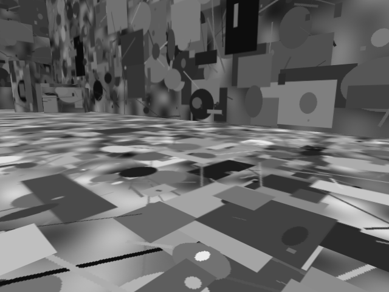
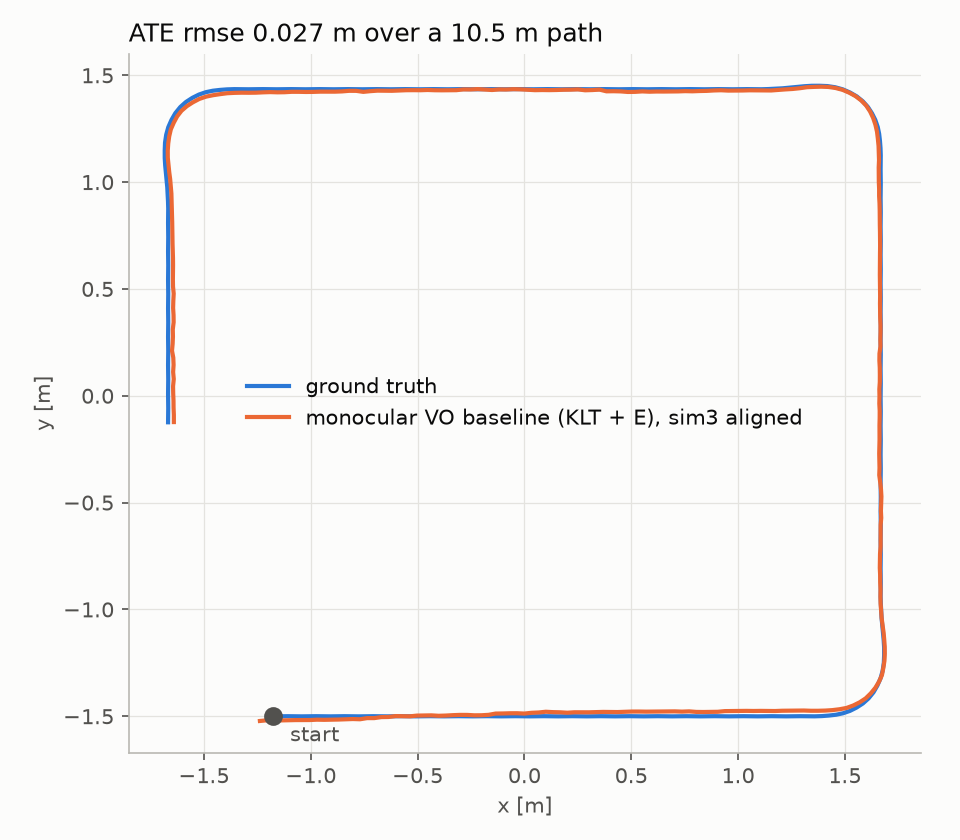
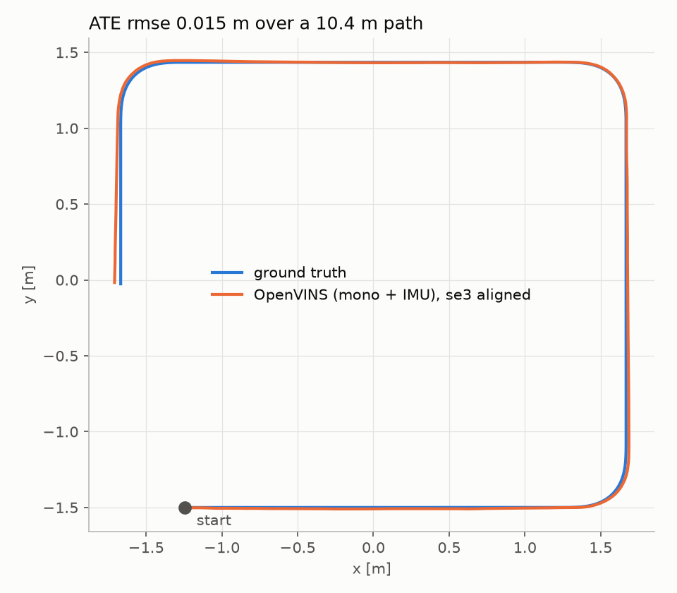
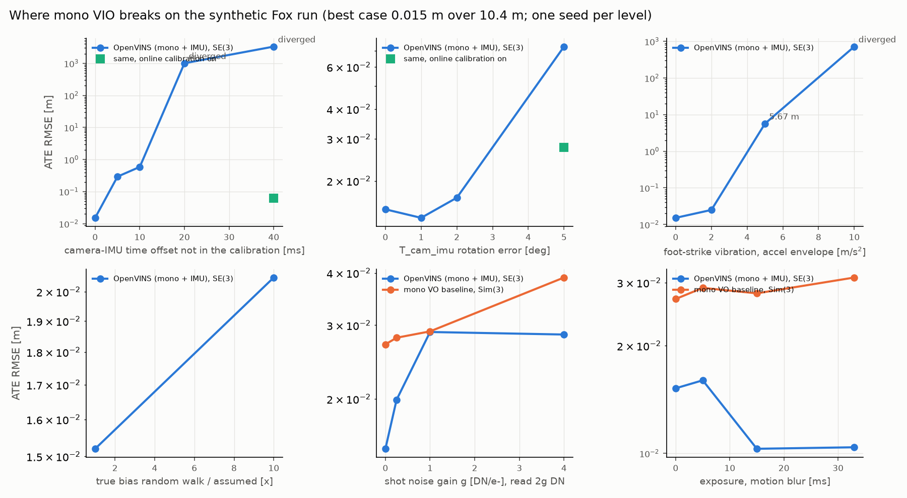

# Fox camera + IMU odometry (sim-first draft)

**Goal:** visual-inertial odometry on Fox: a camera on the Pi plus the BNO055, calibrated together with Kalibr, running
OpenVINS while the v7 policy walks. Today the Pi has no camera and the policy has only walked in simulation, so this
draft builds and proves the whole pipeline on synthetic data first, and prepares the hardware session.



## What works now (measured, synthetic data, 2026-10-12)

| Step | Result |
|---|---|
| Dataset `sim_v1` (`make_dataset.py`, seed 0) | 57.0 s; cam0 1710 frames at 30 Hz (640×480 mono PNG); imu0 and ground truth 11401 samples at 200 Hz; base path 10.30 m; 178 MB EuRoC folder + 506 MB ROS 2 bag |
| Self-checks (`make_dataset.py --check`, plus an assert on every run) | marker projected through the yaml's K and T_cam_imu lands 0.129 px from where MuJoCo renders it; noise-free IMU re-integrates to the true velocity (assert < 2 mm/s) |
| Monocular VO baseline (`vo_baseline.py`), Sim(3)-aligned | 342 keyframes (6 Hz); ATE RMSE **0.027 m** (mean 0.020, max 0.068) over the 10.46 m camera path |
| OpenVINS, mono + IMU (`openvins/`), SE(3)-aligned | static init (still window, then the start of walking at 5.0 s): first pose at 5.77 s; 1537 poses; ATE RMSE **0.015 m** (mean 0.012, max 0.042) over 10.43 m; Sim(3) scale 0.994 (metric scale from the IMU) |

 

**Read these numbers as an upper bound.** The images have no noise, blur, exposure changes or rolling shutter; the IMU
has no foot-strike impacts or servo vibration; OpenVINS gets the exact intrinsics, extrinsics and noise model. The VO
baseline is not VIO: each keyframe step has unit length and evo's Sim(3) fit supplies one scale, which only works because
the synthetic robot walks at a constant 0.2 m/s.

### The synthetic setup
* **Robot and camera:** the v7 MJCF (`v7/mjcf/scene_reduced.xml`) with a camera centred on the nose: 0.125 m ahead of the base
  origin, 0.015 m up, pitched 10° down. Pinhole, fx = fy = 400 px, cx = 319.5, cy = 239.5 (HFOV 77.3°, VFOV 61.9°),
  no distortion. This is a chosen OV9281-like setup, not a measured lens.
* **Scene:** a 6 × 6 m room with 2.5 m walls and 16 boxes along the walls. Every surface has its own non-repeating
  procedural texture (colour noise under thousands of random shapes, many sizes). Lighting is static and shadow-free.
* **Motion:** the base is **kinematic**: its pose is set every sample from a scripted trajectory, with no physics and the
  legs held at home. No Isaac Lab run is recorded on disk to replay. The script: stand 5 s, ramp to 0.2 m/s, then three
  90° left turns (4 s each) between straights. A trot-like overlay scales with speed: 6 mm peak-to-peak bob and ±1°
  pitch at 3 Hz, ±1.5° roll at 1.5 Hz. These values are chosen. The v7 policies only walk straight, so the turns are an
  assumption.
* **IMU:** the BNO055's own frame, mounted upside down (`deploy/fox_pi.py` `IMU_TO_BODY`), at the MJCF `imu` site. It
  is derived from the 1 kHz trajectory and sampled at 200 Hz. Noise model:

  | Term | Accel | Gyro | Source |
  |---|---|---|---|
  | Noise density | 150 µg/√Hz | 0.014 °/s/√Hz | BNO055 datasheet rev 1.8, Table 0-2, typ |
  | Initial bias, drawn uniformly within | ±80 mg | ±1 °/s | same table, typ zero-g / zero-rate offset |
  | Bias random walk | 1e-3 m/s³/√Hz | 1e-4 rad/s²/√Hz | **assumed**: the datasheet gives no figure |
  | Quantisation | 0.01 m/s² | 1/16 °/s | BNO055 output LSB |

## Where it breaks: degradation sweep (round 2, 2026-10-12)

`vio/sweep.py` re-runs OpenVINS on modified copies of the same `sim_v1` images and IMU, with no
re-render. There is one seed per level and the bag plays at 2x. The best case is 0.0152 m ATE.
The results are in [`results/sweep.csv`](results/sweep.csv).



1. **Camera-IMU time offset is the biggest calibration risk.**
   - When the offset is missing from the calibration, ATE is 0.29 m at 5 ms and 0.59 m at 10 ms.
   - At 20 ms it diverges (1007 m).
   - With OpenVINS's online time-offset calibration turned on, a 40 ms offset still comes back to
     0.062 m. Measure the offset with Kalibr, or leave online calibration on.
2. **Mounting-angle error is milder.**
   - Rotation error in T_cam_imu: 1 deg gives 0.014 m, 2 deg 0.017 m, 5 deg 0.073 m.
   - With online extrinsic calibration, 5 deg comes back to 0.028 m.
3. **Foot-strike vibration breaks it first.**
   - The model is a damped 25 Hz ring at every trot touchdown, in the IMU only.
   - A 2 m/s^2 accelerometer envelope gives 0.025 m. 5 m/s^2 diverges (5.7 m) and 10 m/s^2 gives 720 m.
   - On the real robot, measure the vibration (`record_euroc.py`'s IMU-only mode while walking)
     before trusting VIO. If it is large, isolate the IMU or the camera-IMU bracket.
4. **Bias drift, image noise and blur barely matter at these levels.**
   - A 10x stronger bias random walk than assumed: 0.021 m.
   - Shot and read noise up to gain 4: 0.029 m. The VO baseline goes from 0.028 to 0.039 m over the same range.
   - Rotation-only motion blur up to a 33 ms exposure: 0.010-0.016 m.
   - With one seed per level, differences of about 1 cm are within run-to-run noise.

Not covered yet:
- The vibration is applied to the IMU only, so the camera does not shake.
- There is no rolling shutter, and the speed is constant.
- Not checked: whether robot parts appear in the camera view. The bottom of `figures/cam0_sample.png`
  shows dark shapes, so check and mask them before using real data.

## How to run
```bash
python3 -m venv ~/.venvs/fox_vio && ~/.venvs/fox_vio/bin/pip install mujoco==3.15.0 numpy scipy \
    opencv-python-headless matplotlib evo rosbags pyyaml pillow
export MUJOCO_GL=egl
~/.venvs/fox_vio/bin/python vio/make_dataset.py ~/data/fox_vio/sim_v1 --check   # projection self-check
~/.venvs/fox_vio/bin/python vio/make_dataset.py ~/data/fox_vio/sim_v1
~/.venvs/fox_vio/bin/python vio/vo_baseline.py ~/data/fox_vio/sim_v1 --plot vio/figures/vo_baseline.png
# OpenVINS (ROS 2 Humble in Docker; ~7 min to build once, real-time playback)
docker build -t fox-openvins vio/openvins
~/.venvs/fox_vio/bin/python vio/openvins/prepare.py ~/data/fox_vio/sim_v1    # rosbags bag + OpenVINS yamls
vio/openvins/run.sh ~/data/fox_vio/sim_v1
~/.venvs/fox_vio/bin/python vio/vo_baseline.py ~/data/fox_vio/sim_v1 --est ~/data/fox_vio/sim_v1/openvins/ov_estimate.tum \
    --frame imu --align se3 --label "OpenVINS (mono + IMU)" --plot vio/figures/openvins.png
```
Output layout: `mav0/cam0/data/<ns>.png` + `data.csv` + `sensor.yaml`, `mav0/imu0/data.csv` + `sensor.yaml`,
`mav0/state_groundtruth_estimate0/data.csv` (IMU frame), plus Kalibr-format `camchain-imucam.yaml` and `imu.yaml`.
OpenVINS notes: the ROS 2 node reads `filepath_est` only from ROS params, so `run.sh` uses `ros2 run`, not the launch
file. Static init failed with a 2 s stand at the start and worked with 5 s. The node did not exit on SIGINT, so `run.sh`
sends SIGTERM.

## Hardware prep (written, nothing run)
* `kalibr/aprilgrid.yaml`, `kalibr/imu.yaml` (BNO055 values as above), `kalibr/camchain_template.yaml` (with the CAD
  T_cam_imu as a prior to check Kalibr's result against), `kalibr/CHECKLIST.md` (the calibration session).
* `pi/record_euroc.py`: picamera2 + BNO055 at ~200 Hz (raw ACCGYRO mode, one 18-byte I2C burst per sample), both
  stamped on CLOCK_MONOTONIC, written in the same EuRoC layout. It never touches the PCA9685; `--no-camera` makes the
  long static log for the Allan variance. It can't run alongside `deploy/fox_pi.py`, which needs the BNO055 in IMUPLUS
  fusion mode.

## Hardware needed
* **A global-shutter camera is preferred.** A trotting body pitches and rolls at several Hz and the servos vibrate.
  A rolling shutter skews every frame under that motion, and OpenVINS and Kalibr's camera–IMU calibration both
  assume a global shutter. Options checked against the vendors' docs (no prices; check stock and shipping before buying):
  * OV9281 module, e.g. Arducam: mono, global shutter, 1280×800, 3 µm pixels, 1/4". libcamera supports it on the Pi
    (`dtoverlay=ov9281`, `,arducam` for Arducam modules). Closest to the simulated camera.
  * Raspberry Pi Global Shutter Camera: IMX296, 1456×1088, 3.45 µm, colour, C/CS-mount lens. Bigger and heavier.
  * Camera Module 3 (IMX708) is **rolling shutter**: 66° × 41° (standard) or 102° × 67° (Wide). Fine for a first
    test with short exposures, not the target.
* **Field of view:** about 80–100° horizontal. Wide enough to keep features through turns and close to walls, without
  needing a fisheye model. If the lens is wider, calibrate with `pinhole-equi`.
* **Mounting:** on the nose, on the same rigid part as the BNO055, and no vibration damping between the two (they must
  move together). Pitch it 5–15° down so the floor ahead is in view. Keep the legs out of the FOV at full swing. Relieve
  the strain on the CSI ribbon. Lock the M12 focus.

## Next steps
1. Choose and buy a camera (verify stock and shipping first), mount it, then run `kalibr/CHECKLIST.md`. Do the
   Allan-variance log first, to replace the assumed random walks.
2. Make one process own the BNO055 while walking: `fox_pi.py` reads gyro + gravity in fusion mode at 50 Hz, but VIO
   wants raw accel + gyro at about 200 Hz. Either log raw data in `fox_pi.py` or run an IMU service that both use.
3. Make the sim harsher before trusting the numbers: image noise, motion blur and exposure, foot-strike and servo
   vibration in the IMU, a rolling-shutter variant, stop-and-go speed (this breaks the VO's unit-step scale), and turning
   in place.
4. Replay a policy run instead of the script: `tools/gait_report.py --record` saves base pos/quat at the policy rate,
   which needs a spline before it can be differentiated into an IMU.
5. First real result: record with the policy walking on the robot, run OpenVINS with the Kalibr output, and score it
   against a tape-measured loop (it closes on the start mark) or an external tracker.
